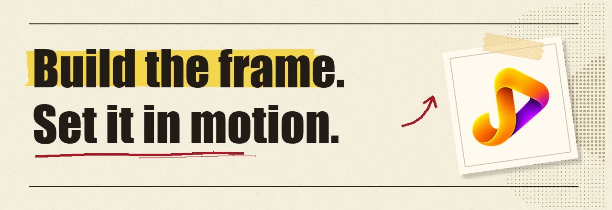
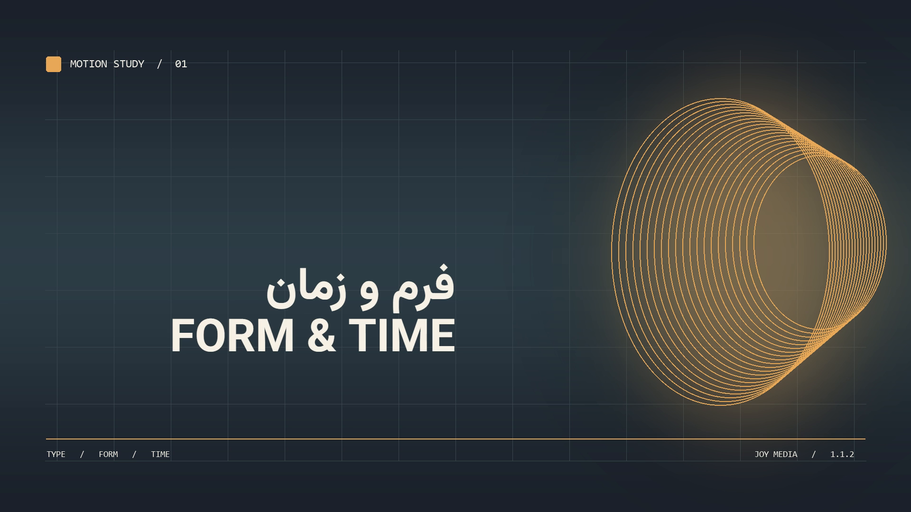

# 

**A Windows desktop editor for graphic and motion design.** Layer artwork and video, set type, animate with keyframes, and finish on a multitrack timeline.

[](https://github.com/hadimoti/joy-media/releases/tag/v1.1.2)
[](docs/USER-GUIDE-v1.1.2.md)
[](RELEASE_NOTES_v1.1.2.md)
[](LICENSE)

## From type on a canvas to a finished MP4

In this motion study, a bilingual title fades in over a field of gold rings. The title and artwork occupy separate tracks so their spacing, timing, and animation can be adjusted independently.

[](docs/images/v1.1.2/studio.png)

1. **Build the frame.** Choose a canvas format, bring in your artwork and video, and stack the elements on tracks.
2. **Shape the type and color.** Position the title in the Monitor, use smart guides to line it up, and refine the look in the Typography and Color panels.
3. **Set the timing.** Add keyframes, scrub the Timeline to check when the title becomes visible, and adjust the audio and captions as needed.
4. **Export the result.** Select **Export MP4**, review the preset and any warnings, and find the completed file in **Recent processes**.

[](docs/images/v1.1.2/rendered-frame.png)

[Projects workspace](docs/images/v1.1.2/projects.png) · [Typography panel](docs/images/v1.1.2/typography.png) · [Color panel](docs/images/v1.1.2/color.png) · [Joy Code settings](docs/images/v1.1.2/joy-code-settings.png)

## What changed in v1.1.2

- **Asset Library.** Image and video cards show previews, with stricter checks on library folders.
- **Monitor.** Snap elements to guides, edges, or other objects and check their position, size, and angle on the canvas.
- **Timeline and Inspector.** More reliable clip selection and dragging, split at the playhead, and Inspector changes that take one Undo step each.
- **Speech and Joy Code.** Generate captions and voice-over with configured local speech models. Joy Code improves preset lookup, provider errors, chat formatting, and Settings navigation.

Core editing runs locally, without a JOY account. Local speech tools need their models and dependencies configured. Optional AI generation and Joy Code requests use the provider you select and may incur provider charges. See the [full changes and known limits](RELEASE_NOTES_v1.1.2.md).

## Install on Windows

Get the x64 installer, portable ZIP, and `SHA256SUMS.txt` from the [v1.1.2 release](https://github.com/hadimoti/joy-media/releases/tag/v1.1.2). To verify the installer, run this command from the download folder in PowerShell.

```powershell
Get-FileHash .\joy-media-setup.exe -Algorithm SHA256
```

Match the `Hash` value to the installer entry in `SHA256SUMS.txt`. The installer is unsigned, so Windows may show a publisher warning. See the [installation and verification steps](docs/USER-GUIDE-v1.1.2.md#install-and-check-the-download).

## Help and contributor setup

- [Projects and workspaces](docs/USER-GUIDE-v1.1.2.md#projects-and-workspaces) · [Menus and shortcuts](docs/USER-GUIDE-v1.1.2.md#menus-and-shortcuts) · [Feature index](docs/USER-GUIDE-v1.1.2.md#feature-index)
- [Typography, right-to-left text, and local speech](docs/USER-GUIDE-v1.1.2.md#typography-and-captions) · [Joy Code, settings, and permissions](docs/USER-GUIDE-v1.1.2.md#joy-code-settings-and-permissions)
- [Audio, Timeline, and delivery](docs/USER-GUIDE-v1.1.2.md#audio-timeline-and-delivery) · [Known limits](docs/USER-GUIDE-v1.1.2.md#known-limits)
- [Developer and contributor guide](docs/DEVELOPMENT.md) · [MIT License](LICENSE)

JOY Media is built with Electron and React and released under the MIT License.
