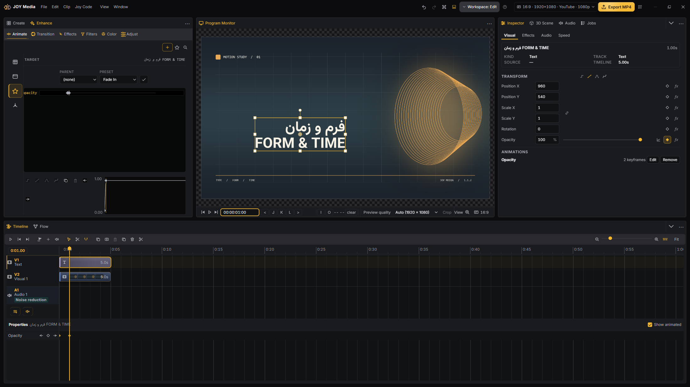

<div align="center">

# JOY Media

### A Windows editor for graphic and motion design

Build layered compositions, refine typography, motion and color, and finish them on a multitrack timeline. JOY Media is a local desktop app; optional AI features connect to the provider you configure.

[v1.1.2 Windows downloads](https://github.com/hadimoti/joy-media/releases/tag/v1.1.2) · [Designer guide](docs/USER-GUIDE-v1.1.2.md) · [Release notes](RELEASE_NOTES_v1.1.2.md) · [MIT license](LICENSE)

</div>



## Make a composition

1. **Start with a project.** Set its canvas format, bring in media, and organize layers and tracks.
2. **Shape the design.** Create titles and captions, then adjust position, scale, color and motion.
3. **Review timing.** Scrub the Monitor and Timeline together, add keyframes, and refine audio.
4. **Export an MP4.** Choose the output preset, check any warnings, and keep the completed file from Recent processes.

The editor can work with local media without an AI connection. Local speech tools need their models and dependencies configured; AI generation or Joy Code requests use the provider you select and may incur provider charges.

## What's in v1.1.2

- A clearer Asset Library preview for images and videos, plus stricter library-folder checks.
- Monitor smart guides, snapping and an on-canvas position, size and angle readout.
- More reliable timeline selection and dragging, split-at-playhead, and inspector value entry with one Undo step per change.
- On-device speech-to-caption and text-to-speech workflows, with setup and model requirements described in the [designer guide](docs/USER-GUIDE-v1.1.2.md).
- Joy Code improvements for preset lookup, provider errors, chat formatting and Settings navigation.

See [all changes and known limits](RELEASE_NOTES_v1.1.2.md) before upgrading.

## Get the Windows app

Download the installer and `SHA256SUMS.txt` from the [v1.1.2 release](https://github.com/hadimoti/joy-media/releases/tag/v1.1.2). Compare the installer hash before opening it.

```powershell
Get-FileHash .\joy-media-setup.exe -Algorithm SHA256
```

Match the `Hash` value with the installer entry in `SHA256SUMS.txt`. The v1.1.2 installer is unsigned, so Windows may show a warning. See the [installation and verification steps](docs/USER-GUIDE-v1.1.2.md#install-and-check-the-download).

## Guides

| Find                                      | Read                                                                                                                                                    |
| ----------------------------------------- | ------------------------------------------------------------------------------------------------------------------------------------------------------- |
| Install, projects and workspaces          | [Installation](docs/USER-GUIDE-v1.1.2.md#install-and-check-the-download) · [Projects and workspaces](docs/USER-GUIDE-v1.1.2.md#projects-and-workspaces) |
| Tools and shortcuts                       | [Menus and shortcuts](docs/USER-GUIDE-v1.1.2.md#menus-and-shortcuts) · [Feature index](docs/USER-GUIDE-v1.1.2.md#feature-index)                         |
| Type, right-to-left text and local speech | [Typography and captions](docs/USER-GUIDE-v1.1.2.md#typography-and-captions)                                                                            |
| Joy Code, model settings and permissions  | [Joy Code and settings](docs/USER-GUIDE-v1.1.2.md#joy-code-settings-and-permissions)                                                                    |
| Audio and export                          | [Timeline and delivery](docs/USER-GUIDE-v1.1.2.md#audio-timeline-and-delivery) · [Known limits](docs/USER-GUIDE-v1.1.2.md#known-limits)                 |

- [Projects in a restored window](docs/images/v1.1.2/projects.png) · [Typography](docs/images/v1.1.2/typography.png) · [Color](docs/images/v1.1.2/color.png) · [Joy Code Settings](docs/images/v1.1.2/joy-code-settings.png) · [Frame from the exported MP4](docs/images/v1.1.2/rendered-frame.png)
- [v1.1.2 guide for designers](docs/USER-GUIDE-v1.1.2.md)
- [v1.1.2 release notes and known limits](RELEASE_NOTES_v1.1.2.md)
- [Developer and contributor guide](docs/DEVELOPMENT.md)

## Project

JOY Media is licensed under the [MIT License](LICENSE). The desktop editor is built with Electron and React. Project and media data stay on the computer unless you choose an external AI provider or export files to another location.
