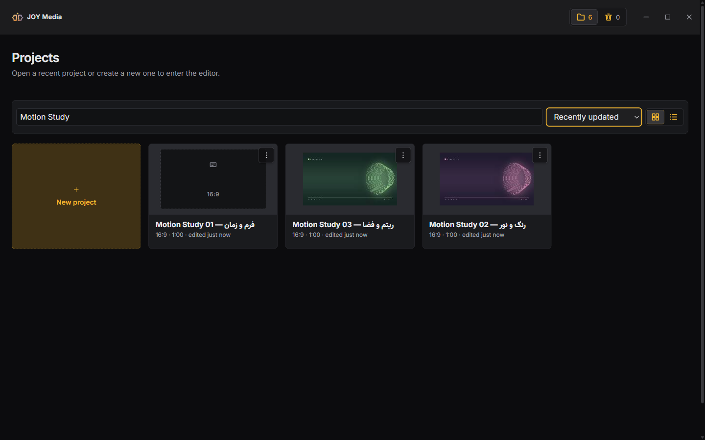
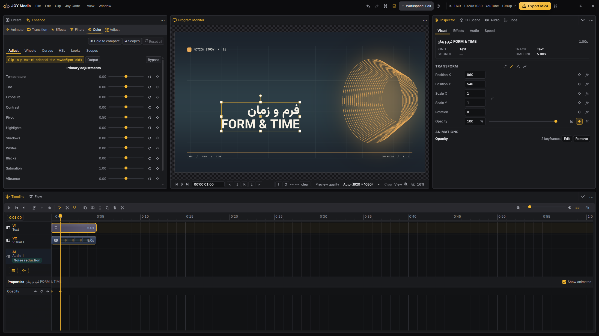

# JOY Media v1.1.2 · Designer guide

This guide covers the Windows desktop editor's main design workflows. Menu labels below refer to the v1.1.2 interface. For implementation and build instructions, see the [developer guide](DEVELOPMENT.md); for the complete change list and known limits, see the [release notes](../RELEASE_NOTES_v1.1.2.md).

## Install and check the download

1. Download the Windows x64 installer `joy-media-setup.exe` and `SHA256SUMS.txt` from the [v1.1.2 release](https://github.com/hadimoti/joy-media/releases/tag/v1.1.2). The portable ZIP is on the same page.
2. In PowerShell, calculate the installer hash:

   ```powershell
   Get-FileHash .\joy-media-setup.exe -Algorithm SHA256
   ```

3. Compare the `Hash` value with the matching installer line in `SHA256SUMS.txt`. If the values differ, delete the download and fetch it again from that release.
4. Run the installer. The installer is unsigned, so Windows may show a publisher warning.

The first launch opens the editor in native fullscreen. Use the Restore control in the app header to return to a resizable window. Use **View → Toggle Full Screen** or **F11** to switch fullscreen again.

## Projects and workspaces



### Create or open a project

On the **Projects** screen, choose **New project**, select a canvas format, enter a name and choose **Create project**. Use the search field, sort menu, and **Grid view / List view** controls to find existing work. Click a project card to open it; use its actions menu to rename, duplicate or move it to Trash. The **Trash** tab lets you restore or permanently remove a project.

Project names may contain Persian, Arabic and English text. The full name is available through the card's accessible name and title even when the visible line is shortened.

### Choose a workspace and find a panel

Use **Workspace** in the editor header to choose a layout:

- **Edit** — media, Monitor, Inspector and Timeline.
- **Enhance** — motion, effects, transitions and color tools.
- **Audio & Captions** — audio and caption tools beside the Monitor and Timeline.
- **Automate** — Joy Code, Workflows and Jobs.
- **Custom** — your manually docked panel arrangement.

Panel tabs sit along each dock group's edge. When the group is too narrow to show every tab, open Dockview's overflow menu to reach the hidden panels. Workspace presets keep their own layouts; choose **Custom** to arrange panels for a particular task.

### Menus and shortcuts

| Menu     | Common actions                                                                                                                                                                                                                                     |
| -------- | -------------------------------------------------------------------------------------------------------------------------------------------------------------------------------------------------------------------------------------------------- |
| File     | Open **Projects Library**, import or export an editable project, or export the current video. An editable project keeps project data for further editing.                                                                                          |
| Edit     | Undo and redo with **Ctrl+Z** and **Ctrl+Y**. Cut, copy and paste with **Ctrl+X**, **Ctrl+C** and **Ctrl+V**. **N** toggles snapping. Press **Ctrl+K** to search the Command Palette. Use **Asset Library Folder** to manage the library location. |
| Clip     | Select a clip and press **S** to split at the playhead, **Ctrl+D** to duplicate, or **Delete** to remove it. **Speed** is available for video clips.                                                                                               |
| Joy Code | Open the composer or its settings, choose Execution Mode, show or follow the active target, and stop the active run.                                                                                                                               |
| View     | Open a panel by name. Press **F11** to toggle fullscreen.                                                                                                                                                                                          |
| Window   | Focus Media, Program Monitor, Timeline or Inspector. Use **Ctrl+M** to minimize or **Alt+F4** to close the window.                                                                                                                                 |

### Feature index

Use the **View** menu to open a panel that is missing from the current workspace. Many tools show their editing controls after you select a timeline clip, layer or track.

| Surface                            | What to use it for                                                                                                                                              |
| ---------------------------------- | --------------------------------------------------------------------------------------------------------------------------------------------------------------- |
| Create → Media                     | Import video, audio and images. Use the library filters and Grid or List view to find assets, then place them at the playhead.                                  |
| Create → Text and Captions         | Add titles, lower thirds or captions. Select the result to edit typography, alignment, cues or timing. See [Typography and captions](#typography-and-captions). |
| Create → Audio                     | Enhance a voice or audio clip, adjust the mix, and inspect audio runtime availability.                                                                          |
| Create → Templates                 | Browse the built-in categories, such as Titles and Lower Thirds, or find saved templates and favorites. Open **My Motions** for saved motion work.              |
| Enhance → Animate                  | Choose a motion preset or use animation controls to keyframe a selected layer. Inspect the resulting property lanes in the Timeline.                            |
| Enhance → Transitions              | Choose a transition at a cut between two clips, then review the junction in the Monitor.                                                                        |
| Enhance → Effects and Filters      | Select a clip before applying a preset. Inspect the clip's effect stack to adjust or remove the effect.                                                         |
| Enhance → Color                    | Grade with adjustments, wheels, curves and HSL. Use Looks for reusable treatments and Scopes to inspect the image.                                              |
| Enhance → Adjustment Layers        | Place adjustments on their own layer, then use the Timeline to control where they affect the composition.                                                       |
| Program Monitor                    | Scrub and play, change preview quality and zoom, crop a visual clip, and position or scale a layer with on-canvas controls.                                     |
| Timeline and Flow                  | Arrange tracks and clips in the Timeline. Switch to **Flow** for the project's node view.                                                                       |
| Inspector                          | See the selected clip's properties. Visual, Enhancements, Mask, Effects, Audio and Speed tabs depend on the selection.                                          |
| 3D Scene and Camera                | Open the scene and camera panels when working on 3D scene elements.                                                                                             |
| History and Jobs                   | Inspect edit history and follow asynchronous jobs such as renders.                                                                                              |
| Workflows, Diagnostics and Plugins | Open workflow tools, inspect runtime information, or manage installed plugins from their respective panels.                                                     |
| Canvas format and Export           | Set the aspect ratio and dimensions in the header. Use the export preset and MP4 controls when the composition is ready.                                        |

## Create, Enhance and refine



- In **Edit**, use the **Media**, **Text** and **Captions** libraries to browse assets and add them to the project. A library category is selected from its category rail; search and browse the cards in the adjacent area.
- In **Enhance**, choose **Motion** for animation presets or **Color** for grading controls. Effects and Transitions are available in the same workspace.
- Select a clip or layer on the Timeline to inspect it. The **Inspector** identifies the selected item and exposes its available property tabs. Type a numeric value or drag over a supported numeric control to scrub; use the row's reset and animation controls as needed. Each value edit is one Undo step.
- Use the **Monitor** to position and scale the selected visual layer. Smart guides show alignment to the frame, safe margins, guides and other objects. Snapping engages near those targets; hold **Ctrl** temporarily to bypass snapping. The on-canvas readout reports position, size and angle.

For a keyed change, move the playhead to the time you want, select a property in the Inspector and use its keyframe control. The Timeline's animated-properties area shows keyed values for the selected object; enable its explicit toggle/filter to inspect lanes. Scrub the playhead to compare the composition and timing.

## Typography and captions


### Text

Open **Edit → Text**, choose a title or text asset, and add it to the project. Select the resulting layer and edit its text and available styling controls. The editor handles Persian and Arabic shaping in preview and export; keep URLs and mixed-script strings as intended, and review the rendered result at full size.

### Captions and speech

Choose the **Audio & Captions** workspace, then open **Captions**:

- **Transcript** lets you edit caption text and timing. Press **Enter** in a cue to split it at the cursor, **Ctrl+Enter** to save the text, or **Backspace** at the start of a cue to join it to the previous cue.
- **Style** provides caption appearance controls when a caption track is selected.
- **Generate** creates speech from text. English voices use Kokoro 82M or Chatterbox English; the Persian voice uses Chatterbox Persian Expressive. Chatterbox can use a reference recording already placed on the Timeline. Use only a voice you have permission to use.

To create captions from speech, select the voice clip on the Timeline and use the speech transcription action in **Captions → Transcript**. English and Persian recognition runs locally with faster-whisper large-v3-turbo. The local speech runners, Python dependencies and model files must be installed and configured first; JOY Media reports which engines are ready. Configure an FFmpeg path for speech if your audio setup requires one. This workflow does not require a provider account or send the recording to an AI service.

**License note:** Chatterbox Persian Expressive by Ramin Mahmoodi is distributed under [CC BY-NC 4.0](https://creativecommons.org/licenses/by-nc/4.0/), which permits non-commercial use only. Review the model's [license and attribution](https://huggingface.co/ramin-mahmoodi/Chatterbox-Persian-Expressive) before using it.

## Joy Code, settings and permissions


Open **Automate → Joy Code**. The gear button opens **Joy Code Settings**, with pages for **AI models**, **Safety and limits**, **Live preview**, **Tools and permissions**, and **Media support check**.

1. In **AI models**, connect a provider or select a saved profile and model. Supply your own provider account or API key. Saved API keys are encrypted on this PC with Windows DPAPI. Requests to external providers require a network connection and may incur charges on your provider account.
2. In **Safety and limits**, choose how much Joy Code may do on its own. **Preview and approve** is the default: review a rendered preview and approve or reject the proposed edit. **Suggest only** provides advice without changing the project. Other execution modes and cost thresholds depend on the selected settings.
3. In **Tools and permissions**, allow only the capabilities you want Joy Code to use, such as reading or changing the timeline, importing media, accessing files, generating media, spending with a provider, rendering previews or exporting.
4. In **Live preview**, choose whether changes are shown on the canvas while Joy Code works. The **Media support check** can send three tiny test clips to the configured provider to check picture, sound and video understanding; it does not send your project or media, but the provider may charge for those checks.

| Setting               | What it controls                                                                                                                                                                                                                                             |
| --------------------- | ------------------------------------------------------------------------------------------------------------------------------------------------------------------------------------------------------------------------------------------------------------ |
| AI models             | Connection profiles, the Workhorse and Creative Brief assignments, model selection, effort level and model instructions. Use **Refresh list** to request the provider's current catalog or enter a **Model ID** when the connection supports it.             |
| Safety and limits     | Select the execution mode and set autonomy, cost, local-only and quality check limits. Quality check has separate limits for frames per check, frames per run and fix rounds. Turn on **Never send frames to a remote model** to keep the frames on this PC. |
| Live preview          | Choose how proposed changes are shown while Joy Code runs. Use the preview and approval controls to inspect a proposed change before applying it.                                                                                                            |
| Tools and permissions | Control project and timeline edits, imports, local file access, AI media generation, paid provider use, preview rendering and export.                                                                                                                        |
| Media support check   | Check which media a connected model can understand. The check uses short test inputs for the selected media type.                                                                                                                                            |

Use **Edit** for changes, **Creative Brief** for design direction, **Recipes** for reusable workflows and **Looks** for supported look workflows. During a run, the **Joy Code** menu shows the activity and can jump to or follow its target. Use **Stop** in the current composer or **Stop active run** in the menu.

Joy Code can stage supported title, caption and transition presets for preview and approval. Ordinary filters and effects are suggestions you can apply from **Enhance**. The [bundled Joy Code skills](../.agent/skills) give agents workflows for typography, captions, transitions, color, motion and export review. The Windows package also includes the guides under `resources/app/joy-code-skills`.

## Audio, Timeline and delivery

The **Audio & Captions** workspace includes **Audio** with **Enhance**, **Mix** and **Runtime** tabs. Audio tools may run locally, in the browser or through a remote provider depending on the selected capability; check the displayed route before starting a remote operation. For on-device speech generation, use **Captions → Generate** as described above.

The Timeline runs left to right in time. Select a clip, use the **Select** or **Split** tool, and scrub the ruler or playhead to review a frame. The **Split at playhead** toolbar action cuts the selected clip at the playhead. **Space** plays or pauses when the Timeline or Monitor has focus; text fields and dialogs keep their normal typing behavior. Tracks provide lock, hide, mute and solo controls.

Choose **Export MP4** in the editor header. Check the selected output preset and any warnings before starting. Follow progress in the editor; cancel if needed, then retry a failed export or download a completed file from **Recent processes**.

## Known limits

- The app is unsigned; Windows may show a warning during installation.
- xAI does not yet show the **Signed in** label.
- A missing Asset Library file is requested again at each refresh.
- MiniMax video uses the current request format, but real video generation is not confirmed as available with the tested Go plan; a real request returned a balance/rate-limit response. MiniMax image generation did complete in a real run.
- The Monitor's right-click menu does not yet have **Bring forward** or **Send backward**. Reorder tracks in the Timeline to change stacking. **Esc** does not cancel a title edit on the Monitor yet.
- Generated speech captions currently use one cue per spoken part. Shortening long cues and repairing Persian half-spaces are not yet supported.
- A Chatterbox reference voice must be a clip on the Timeline; an Asset Library-only file cannot be selected yet.
- The Persian Chatterbox voice is non-commercial under CC BY-NC 4.0.

See the [release notes](../RELEASE_NOTES_v1.1.2.md) for the full list of fixes and verification status.
