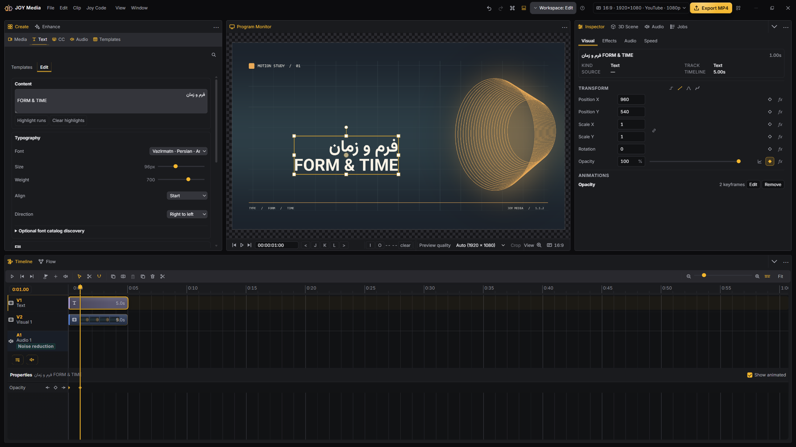
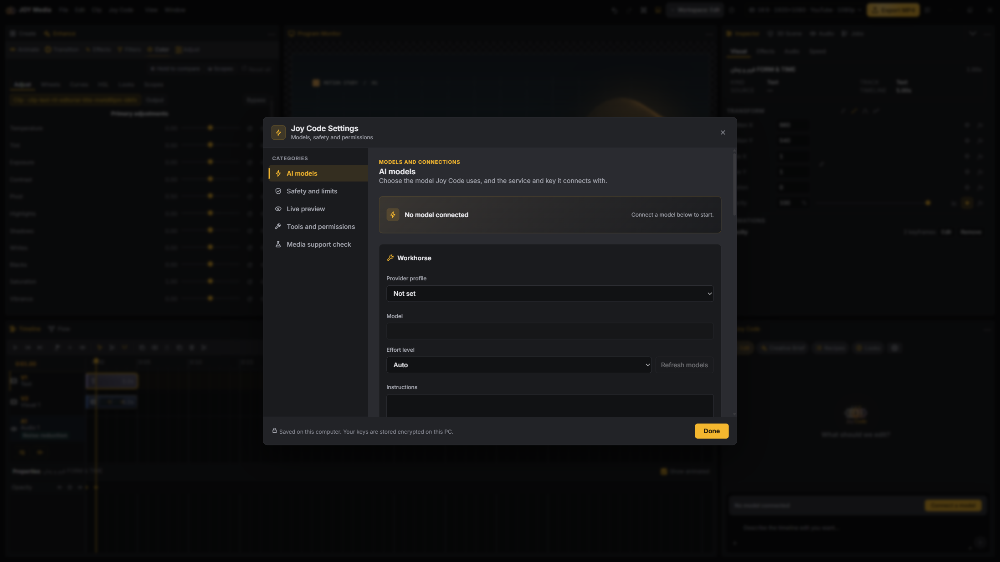

# JOY Media v1.1.2 · Designer guide

This guide covers the Windows desktop editor's main design workflows. Menu labels below refer to the v1.1.2 interface. For implementation and build instructions, see the [developer guide](DEVELOPMENT.md); for the complete change list and known limits, see the [release notes](../RELEASE_NOTES_v1.1.2.md).

## Install and check the download

1. Open the [JOY Media releases](https://github.com/hadimoti/joy-media/releases) page and download the v1.1.2 Windows installer and `SHA256SUMS.txt` from the same release.
2. In PowerShell, calculate the installer hash:

   ```powershell
   Get-FileHash .\joy-media-setup.exe -Algorithm SHA256
   ```

3. Compare the `Hash` value with the matching installer line in `SHA256SUMS.txt`. If the values differ, delete the download and fetch it again from that release.
4. Run the installer. The installer is unsigned, so Windows may show a publisher warning.

The first launch opens the editor in native fullscreen. Use the Restore control in the app header to return to a resizable window. Use **View → Toggle Full Screen** or **F11** to switch fullscreen again.

## Projects and workspaces


### Create or open a project

On the **Projects** screen, choose **New project**, select a canvas format, enter a name and choose **Create project**. Use the search field, sort menu, and **Grid view / List view** controls to find existing work. Click a project card to open it; use its actions menu to rename, duplicate or move it to Trash. The **Trash** tab lets you restore or permanently remove a project.

Project names may contain Persian, Arabic and English text. The full name is available through the card's accessible name and title even when the visible line is shortened.

### Choose a workspace and find a panel

Use **Workspace** in the editor header to choose a layout:

- **Edit** — media, Monitor, Inspector and Timeline.
- **Enhance** — motion, effects, transitions and color tools.
- **Audio & Captions** — audio and caption tools beside the Monitor and Timeline.
- **Automate** — Joy Code, Workflows and Jobs.
- **Custom** — your manually docked panel arrangement.

Panel tabs sit along each dock group's edge. When the group is too narrow to show every tab, open Dockview's overflow menu to reach the hidden panels. Workspace presets keep their own layouts; choose **Custom** to arrange panels for a particular task.

## Create, Enhance and refine

- In **Edit**, use the **Media**, **Text** and **Captions** libraries to browse assets and add them to the project. A library category is selected from its category rail; search and browse the cards in the adjacent area.
- In **Enhance**, choose **Motion** for animation presets or **Color** for grading controls. Effects and Transitions are available in the same workspace.
- Select a clip or layer on the Timeline to inspect it. The **Inspector** identifies the selected item and exposes its available property tabs. Type a numeric value or drag over a supported numeric control to scrub; use the row's reset and animation controls as needed. Each value edit is one Undo step.
- Use the **Monitor** to position and scale the selected visual layer. Smart guides show alignment to the frame, safe margins, guides and other objects. Snapping engages near those targets; hold **Ctrl** temporarily to bypass snapping. The on-canvas readout reports position, size and angle.

For a keyed change, move the playhead to the time you want, select a property in the Inspector and use its keyframe control. The Timeline's animated-properties area shows keyed values for the selected object; enable its explicit toggle/filter to inspect lanes. Scrub the playhead to compare the composition and timing.

## Typography and captions



### Text

Open **Edit → Text**, choose a title or text asset, and add it to the project. Select the resulting layer and edit its text and available styling controls. The editor handles Persian and Arabic shaping in preview and export; keep URLs and mixed-script strings as intended, and review the rendered result at full size.

### Captions and speech

Choose the **Audio & Captions** workspace, then open **Captions**:

- **Transcript** lets you edit caption text and timing. Press **Enter** in a cue to split it at the cursor, **Ctrl+Enter** to save the text, or **Backspace** at the start of a cue to join it to the previous cue.
- **Style** provides caption appearance controls when a caption track is selected.
- **Generate** creates speech from text. English voices use Kokoro 82M or Chatterbox English; the Persian voice uses Chatterbox Persian Expressive. Chatterbox can use a reference recording already placed on the Timeline. Use only a voice you have permission to use.

To create captions from speech, select the voice clip on the Timeline and use the speech transcription action in **Captions → Transcript**. English and Persian recognition runs locally with faster-whisper large-v3-turbo. The local speech runners, Python dependencies and model files must be installed and configured first; JOY Media reports which engines are ready. Configure an FFmpeg path for speech if your audio setup requires one. This workflow does not require a provider account or send the recording to an AI service.

**License note:** Chatterbox Persian Expressive by Ramin Mahmoodi is distributed under [CC BY-NC 4.0](https://creativecommons.org/licenses/by-nc/4.0/), which permits non-commercial use only. Review the model's [license and attribution](https://huggingface.co/ramin-mahmoodi/Chatterbox-Persian-Expressive) before using it.

## Joy Code, settings and permissions



Open **Automate → Joy Code**. The gear button opens **Joy Code Settings**, with pages for **AI models**, **Safety and limits**, **Live preview**, **Tools and permissions**, and **Media support check**.

1. In **AI models**, connect a provider or select a saved profile and model. Supply your own provider account or API key. Saved API keys are encrypted on this PC with Windows DPAPI. Requests to external providers require a network connection and may incur charges on your provider account.
2. In **Safety and limits**, choose how much Joy Code may do on its own. **Preview and approve** is the default: review a rendered preview and approve or reject the proposed edit. **Suggest only** provides advice without changing the project. Other execution modes and cost thresholds depend on the selected settings.
3. In **Tools and permissions**, allow only the capabilities you want Joy Code to use, such as reading or changing the timeline, importing media, accessing files, generating media, spending with a provider, rendering previews or exporting.
4. In **Live preview**, choose whether changes are shown on the canvas while Joy Code works. The **Media support check** can send three tiny test clips to the configured provider to check picture, sound and video understanding; it does not send your project or media, but the provider may charge for those checks.

Joy Code does not have the same behavior for every result. A **native** operation is one the app can stage in its own project and show in the rendered preview/approval flow. A **suggestion-only** result is guidance for you to apply manually; it does not become an edit merely because Joy Code described it. Use the app's available preview and approval controls to tell which applies. Unsupported preset types remain suggestion-only.

The source tree is integrating six scoped Joy Code agent guides under `.agent/skills/joy-code-*`. These are workflow instructions for agents; they do not add runtime features or override the app's configured permissions and approval flow.

## Audio, Timeline and delivery

The **Audio & Captions** workspace includes **Audio** with **Enhance**, **Mix** and **Runtime** tabs. Audio tools may run locally, in the browser or through a remote provider depending on the selected capability; check the displayed route before starting a remote operation. For on-device speech generation, use **Captions → Generate** as described above.

The Timeline runs left to right in time. Select a clip, use the **Select** or **Split** tool, and scrub the ruler or playhead to review a frame. The **Split at playhead** toolbar action cuts the selected clip at the playhead. **Space** plays or pauses when the Timeline or Monitor has focus; text fields and dialogs keep their normal typing behavior. Tracks provide lock, hide, mute and solo controls.

Choose **Export MP4** in the editor header. Check the selected output preset and any warnings before starting. Follow progress in the editor; cancel if needed, then retry a failed export or download a completed file from **Recent processes**.

## Known limits

- The app is unsigned; Windows may show a warning during installation.
- xAI does not yet show the **Signed in** label.
- A missing Asset Library file is requested again at each refresh.
- MiniMax video uses the current request format, but real video generation is not confirmed as available with the tested Go plan; a real request returned a balance/rate-limit response. MiniMax image generation did complete in a real run.
- The Monitor's right-click menu does not yet have **Bring forward** or **Send backward**. Reorder tracks in the Timeline to change stacking. **Esc** does not cancel a title edit on the Monitor yet.
- Generated speech captions currently use one cue per spoken part. Shortening long cues and repairing Persian half-spaces are not yet supported.
- A Chatterbox reference voice must be a clip on the Timeline; an Asset Library-only file cannot be selected yet.
- The Persian Chatterbox voice is non-commercial under CC BY-NC 4.0.

See the [release notes](../RELEASE_NOTES_v1.1.2.md) for the full list of fixes and verification status.
